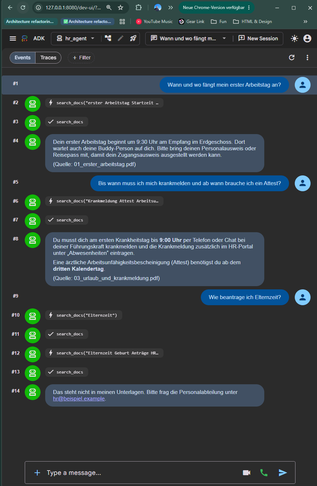

# HR-Onboarding-Agent (MVP)

Ein kleiner KI-Chat-Agent, der neuen Mitarbeitenden organisatorische Fragen zum Onboarding beantwortet,
auf Basis der vorhandenen PDF-Dokumente. Umsetzung der ersten Version aus dem PRD (US1 bis US3) mit dem
[Google Agent Development Kit](https://google.github.io/adk-docs/) und Gemini.

> Die Dokumente in `docs/` sind **fiktive Beispieldokumente**, nur für die Demo geschrieben.
> Echte Onboarding-PDFs werden einfach in `docs/` gelegt, danach einmal `ingest` ausführen.

## Start in drei Schritten

Voraussetzungen: Python 3.14, [uv](https://docs.astral.sh/uv/), ein API-Key aus Google AI Studio.

```bash
uv sync
cp hr_agent/.env.example hr_agent/.env      # GOOGLE_API_KEY eintragen
uv run python -m hr_agent.ingest            # PDFs lesen, Index bauen -> data/
uv run adk web --port 8080                  # Chat-UI: http://127.0.0.1:8080, App "hr_agent" wählen
```

Im ADK-UI sind links die Events sichtbar: welcher Tool-Aufruf gemacht wurde und was die Suche zurückgegeben hat.



Drei Testfragen aus `eval/fragen.md`: die ersten beiden werden mit Quelle beantwortet. Bei der dritten
("Elternzeit") sucht der Agent zweimal mit anderen Begriffen, findet nichts Passendes und verweist an HR,
statt aus den Urlaubsregeln etwas abzuleiten.

## Was passiert bei einer Frage

```
Nutzer:in ──> ADK Web-UI ──> Agent (Gemini)
                               │  1. ruft search_docs(frage) auf
                               ▼
                          tools.search_docs ──> knowledge.search
                                                 │  Frage einbetten (gemini-embedding-001)
                                                 │  Ähnlichkeitssuche im FAISS-Index (data/)
                                                 ▼
                               Treffer: Quelle, Seite, Text, Score
                               │  2. prüft, ob die Treffer die Frage wirklich beantworten
                               ▼
                          Antwort mit (Quelle: datei.pdf)   oder   "Das steht nicht in meinen Unterlagen."
```

| Datei | Aufgabe |
|---|---|
| `hr_agent/agent.py` | Der Agent: Modell, Anweisung (Regeln auf Deutsch), Liste der Tools |
| `hr_agent/tools.py` | `search_docs`: das Werkzeug, das der Agent aufruft |
| `hr_agent/knowledge.py` | PDFs lesen, in Abschnitte schneiden, einbetten, FAISS-Index, Suche |
| `hr_agent/ingest.py` | Pipeline: `docs/*.pdf` -> `data/index.faiss` + `data/chunks.json` |
| `docs/` | Eingabe: die Dokumente (hier fiktiv, Markdown-Quellen + erzeugte PDFs) |
| `data/` | Ausgabe: gebauter Index, nicht im Repo, jederzeit neu erzeugbar |
| `eval/fragen.md` | 10 Testfragen mit erwarteter Quelle, zwei davon absichtlich ohne Antwort |
| `scripts/make_sample_pdfs.py` | erzeugt die Demo-PDFs aus den Markdown-Dateien |

## Entscheidungen und Annahmen

- **ADK**, weil im PRD genannt, Chat-UI (US1) ohne eigenes Frontend, Tools sind normale Python-Funktionen,
  Multi-Agent-Setups (Ausbaustufe 2) sind eingebaut.
- **Eigene Suche mit Embeddings + FAISS** statt Vertex AI Search: bei wenigen Dokumenten reicht das, ist
  lokal testbar und kostet fast nichts. Bei vielen oder häufig wechselnden Dokumenten wäre Vertex AI Search
  oder RAG Engine der nächste Schritt.
- **Die Ähnlichkeit entscheidet nicht, ob eine Antwort existiert.** Eine Frage zu "Elternzeit" findet Abschnitte
  zu "Urlaub" mit hohem Score. Deshalb prüft das Modell die Treffer und nennt immer die Quelle, der Score ist nur
  ein grober Filter.
- **Keine Halluzinationen** heißt hier: Antwort nur aus Treffern, Quelle in jeder Antwort, ausdrücklicher Satz
  "Das steht nicht in meinen Unterlagen" statt Raten. Geprüft mit `eval/fragen.md`.
- Gescannte PDFs ohne Textschicht werden beim `ingest` erkannt und gemeldet (OCR wäre ein eigener Schritt).

## Nicht enthalten (bewusst)

Deployment (Cloud Run), Login und Berechtigungen, Gesprächsspeicher über die Sitzung hinaus,
automatisierte Tests gegen das Modell. Das sind Fragen für den gemeinsamen Termin, nicht für den ersten Abend.

## Offene Fragen an das Team

1. Wo liegen die echten PDFs, wie viele sind es, wie oft ändern sie sich, wer pflegt sie?
2. Dürfen alle Mitarbeitenden alle Dokumente sehen?
3. Welche Modelle und Regionen sind erlaubt (Gemini über Vertex AI in europe-west3)?
4. Wo soll der Agent laufen, wer betreibt ihn danach?
5. Woran merken wir nach vier Wochen, dass er hilft?

## Ausblick (Ausbaustufe 1 und 2 aus dem PRD)

- **Themen erfassen:** ein Tool `log_topic(topic, found_in_docs)` mit fester Themenliste, nur Thema und
  Zeitstempel, kein Fragetext, keine Person. Lokal als `data/topics.jsonl`, später Firestore oder BigQuery
  und eine kleine Auswertung für HR. Verlässlicher als ein Tool-Aufruf wäre ein ADK-Callback nach jeder
  Antwort, dann entscheidet Code und nicht das Modell, ob geloggt wird.
- **Rückfrage bei Experten-Agenten:** in ADK über `sub_agents` oder `AgentTool`, z. B. ein Agent für
  IT-Zugänge (Ticketsystem) und einer für Abwesenheiten (HR-System), plus Übergabe an einen Menschen,
  wenn kein Agent weiterweiß.
